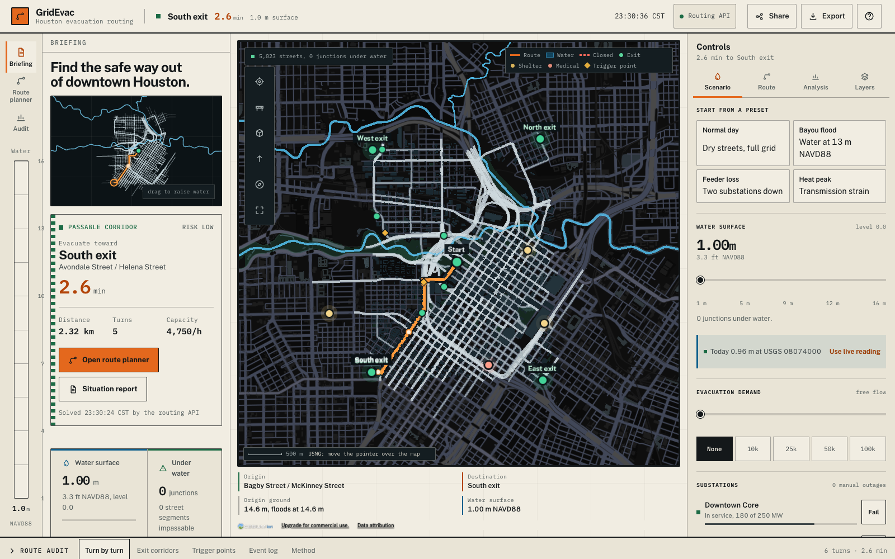

# GridEvac: Houston evacuation routing

Evacuation routing for downtown Houston on the real OpenStreetMap street network and USGS 3DEP terrain. Operators raise the water, take substations offline, and close streets; GridEvac returns the safest passable corridor, turn-by-turn directions, the water level at which each way out is cut off, and exports for the incident log and GIS.

**[Try it live: grid-evac-ai.vercel.app](https://grid-evac-ai.vercel.app)** — no account, no key, nothing to install.



## What it does

**Scenario modeling**
- Water surface on a real elevation scale (metres NAVD88), with a hydrologically connected flood model seeded from Buffalo, White Oak, and Little White Oak bayous. Bridge decks stay dry above flooded ground.
- One-click sync to the live USGS Buffalo Bayou gage (08074000, datum 0.00 ft NAVD88).
- Substation outages with load redistribution and cascade trips; flooded substations trip on their own.
- Operator road closures drawn directly on the map and carried in shared links.
- Evacuation demand with BPR congestion, district clearance time, and shelter capacity against demand.

**Live road conditions**
- Rainfall, 6/24-hour accumulation, the coming 6-hour forecast, wind gusts, and every active NWS watch, warning, and advisory for the district, from two public key-free services (Open-Meteo and `api.weather.gov`).
- Those readings are turned into the two things a roadway actually imposes: how deep water is standing on each junction against the depth each travel mode can cross (NWS "Turn Around Don't Drown": 6 in stalls a car, 12 in floats many), and how much achievable speed drops — wet friction and spray, visibility loss, crosswind on exposed bridge decks, ice, and heat stress on foot.
- Standing water is modeled from the district's own USGS elevations: bayou-adjacent streets pond first and deepest, high ground with intact drainage clears all but a downpour. An active flood warning raises the assumed intensity even when the local gauge is between cells.
- Turn on **Route on these conditions** and the route avoids junctions too deep to cross, pays a depth-scaled delay for driving through water, prefers sheltered streets over exposed decks in high wind, and reports the extra minutes the weather costs against a dry street (`dry_eta_minutes`).

**Decisions**
- Your own destination: drop a pin on the map, search a junction or street by name, or paste a coordinate. A route must end at a junction, so the panel always reports how far the requested point sat from the junction it snapped to.
- Start from your own location: the device fix is snapped to the nearest mapped street, and the route begins at whichever end of that street you can legally reach fastest (one-way rules for vehicles). The access leg is shown on the map and added to the total time. "Follow my location" re-plans as you move. The location stays in the browser; only the chosen junction reaches the API, and it never appears in shared links or exports.
- Least-cost route to the safest usable exit, a named shelter or medical facility, or an operator's own junction. Exits whose own approach is under river water or holding standing water are dropped from the ranking and listed with the reason. Vehicles obey one-way streets; ETAs are real travel time, while penalties for flooded approaches, standing water, blackout districts, and energized lines only decide the order.
- Turn-by-turn directions with left/right maneuvers computed from street geometry.
- Exit corridors ranked safest first, with capacity, hazard counts, and the standing water along each one.
- Trigger points: the exact water surface at which each exit and shelter becomes unreachable, and which street floods first (a widest-path solve over flood stages).
- Street-network reachability in minutes.
- Exposure estimate: buildings and daytime occupants in the flood extent or without power.

**Hand-off**
- Shareable scenario links (origin, water level, mode, outages, demand, destination or pinned point, conditions routing, closures).
- Situation report laid out after the ICS-201 briefing, GeoJSON package for ArcGIS/QGIS, and a CSV operator event log with UTC and Houston local timestamps.
- U.S. National Grid (USNG) coordinates under the cursor, for origins, and in exports.
- Print stylesheet for the briefing and audit.

## Architecture

```
GridEvac/
├── backend/                     FastAPI service (its own Vercel project, root directory `backend`)
│   ├── main.py                  Endpoints, cached city payload, live observations relay
│   ├── routing.py               Flood model, power flow, routing, corridors, isochrones, trigger points
│   ├── conditions.py            Live weather and NWS warnings -> standing water and speed factors
│   ├── city_graph.py            Loads the baked network into NetworkX
│   ├── anomaly.py               IsolationForest risk score
│   ├── models.py                Pydantic schemas
│   └── data/houston_network.json
├── frontend/                    Next.js 14 app (its own Vercel project)
│   ├── app/                     Page shell and global styles
│   ├── components/              Map (CesiumJS), control panel, briefing and audit panels
│   ├── hooks/useSimulation.ts   Zustand store: scenario state, solver orchestration, event log
│   ├── lib/solver.ts            Offline solver: a line-for-line mirror of backend/routing.py
│   ├── lib/conditions.ts        Offline road-condition model: mirror of backend/conditions.py, reads both feeds in the browser
│   ├── lib/terrain.ts           Terrain grid used to draw the flood surface
│   ├── lib/usng.ts              WGS84 to USNG conversion
│   ├── lib/exports.ts           Situation report, GeoJSON, CSV
│   └── public/data/             Baked network and terrain grid for offline mode
├── tools/                       Data bakes and the API mirror sync
└── scripts/api_smoke_test.py    Endpoint checks (runs in-process, no server needed)
```

The frontend works without the API: it loads the same baked network from `/data/houston_network.json` and runs `lib/solver.ts`, which returns the same routes, ETAs, corridors, isochrones, and trigger points as the Python backend.

## Run locally

Requires **Python 3.9+** and **Node.js 18+** (`npm`). Nothing else: the street network and terrain are already baked into the repository.

```bash
bash start.sh
```

`start.sh` creates `backend/.venv`, installs both dependency sets, and starts the two servers:

- Frontend: http://localhost:3000
- Backend: http://localhost:8000 (OpenAPI docs at `/docs`)

To run a part on its own: `cd backend && .venv/bin/uvicorn main:app --port 8000`, or `cd frontend && npm run dev`. The frontend is usable with only the frontend running — it solves in the browser from `/data/houston_network.json`.

Optional environment (`frontend/.env.local`, and in Vercel project settings):

| Variable | Purpose |
|---|---|
| `NEXT_PUBLIC_CARTO_API_KEY` | CARTO basemap key (appended to tile URLs; keep attribution visible) |
| `NEXT_PUBLIC_CESIUM_TOKEN` | Cesium ion token: aerial imagery, world terrain, OSM 3D buildings |
| `NEXT_PUBLIC_API_URL` | API origin when it is not served from the same host |
| `GRIDEVAC_CORS_ORIGINS` | Backend: comma-separated allowed origins (default localhost:3000) |

## Deploy

The site runs as **two Vercel projects from this repository**. Vercel does not build file-based Python functions inside `/api` next to a Next.js app — the framework preset owns every route — so the API is deployed on its own:

| Project | Root directory | How Vercel builds it |
|---|---|---|
| Frontend | `frontend` | Next.js, auto-detected from `package.json` |
| API | `backend` | FastAPI, auto-detected from `requirements.txt`; entrypoint `main.py` (`app`) |

1. **API project** — Add New → Project → import this repo → set **Root Directory** to `backend`. No build command or output directory is needed. `backend/.python-version` pins Python 3.12 (pydantic 2.7.1 has no wheels for 3.13+) and `backend/vercel.json` allows 60 s per request, since `/api/conditions` relays live USGS, Open-Meteo and NWS data. Set `GRIDEVAC_CORS_ORIGINS=https://grid-evac-ai.vercel.app` (comma-separate any preview or custom origins). Then `GET https://<api-project>.vercel.app/health` should return 200 and `/docs` should render.
2. **Frontend project** — set `NEXT_PUBLIC_API_URL=https://<api-project>.vercel.app` and redeploy, because `NEXT_PUBLIC_*` is inlined at build time. With it unset, the browser calls `/api/*` on the frontend origin, gets a 404 and falls back to the in-browser solver: the app still works, it just stops using the Python service.

## API

| Method | Endpoint | Description |
|---|---|---|
| `GET` | `/health` | Service health and data provenance |
| `GET` | `/api/city` | Junctions with flood stages, curved streets with one-way rules, footprints, waterways, utilities, flood model |
| `POST` | `/api/calculate-route` | Scenario route, turn-by-turn steps, utility state, risk |
| `GET` | `/api/compare-corridors` | Every dry perimeter exit, safest first |
| `GET` | `/api/isochrone` | Junctions reachable within N minutes |
| `GET` | `/api/trigger-points` | Water surface at which each exit and shelter is cut off |
| `GET` | `/api/flood-zones` | Flooded junctions for a scenario level |
| `GET` | `/api/observations` | Live USGS gage, discharge, and air temperature (5-minute cache) |
| `GET` | `/api/conditions` | Live rainfall, gusts, standing water per junction, per-mode speed factors, and active NWS warnings |

Example:

```json
POST /api/calculate-route
{
  "flood_level": 8.0,
  "failed_substations": [2],
  "origin_node": 425,
  "travel_mode": "vehicle",
  "evacuees": 30000,
  "destination": "grb",
  "closed_edges": [[425, 426]]
}
```

Scenario level `L` maps to a water surface of `datum + L × rise` metres NAVD88 (published in `/api/city` as `flood_model`).

Routing on live conditions. Send `use_live_conditions: true` to have the server fetch the feeds, or include the `conditions` snapshot your own browser measured — the snapshot wins, so the API's answer matches the offline solver's and a shared link replays identically:

```json
POST /api/calculate-route
{
  "flood_level": 0.0,
  "failed_substations": [],
  "origin_node": 425,
  "travel_mode": "vehicle",
  "use_live_conditions": true,
  "destination_node": 2019,
  "destination_label": "Rally point 4"
}
```

The response carries `road_conditions` (the model actually used, including which junctions the mode cannot cross), `dry_eta_minutes`, `weather_delay_s`, `route_ponded_segments`, and `ponded_edges`. A route that failed because of the weather still returns the conditions it failed against.

## Data pipeline

Run from the repository root with `numpy` and `tifffile` installed. Downloads are cached in `tools/.cache`.

1. `backend/tools/bake_city_network.py`: streets, junctions, footprints, substations, and exits from an OpenStreetMap export.
2. `tools/bake_street_attributes.py`: one-way rules, tagged lanes and speed limits, ramp names.
3. `tools/bake_terrain.py`: USGS 3DEP elevations, connected flood stages, bridge decks, bayou centerlines, and the rendering grid.
4. `tools/bake_shelters.py`: shelters snapped to junctions vehicles can reach and leave.
5. `cp backend/data/houston_network.json frontend/public/data/houston_network.json`: the copy the offline solver loads.

## Verification

```bash
python3 scripts/api_smoke_test.py --inprocess
diff -q backend/data/houston_network.json frontend/public/data/houston_network.json
cd frontend && npm ci && npm run lint && npm run typecheck && npm run build
```

CI runs the same checks on every push and pull request (`.github/workflows/ci.yml`).

## Limitations

- The flood model is a single water surface spreading over connected low ground. It does not model storm-drain backup, or the channel's downstream slope, and the upstream gage stands in for the whole reach.
- Rainfall ponding is a drainage-balance proxy, not a hydraulic model: depth follows rainfall intensity against an assumed drainage capacity, scaled by how low a street sits in the district's 3DEP elevation range. It has no sewer network, no flow direction, and no estimate of how fast water is moving. Live feeds can also be unreachable, in which case the app says so and routes as if the pavement were dry rather than silently guessing.
- Substations, loads, service areas, and transmission links are illustrative, not CenterPoint Energy data.
- Occupancy estimates assume one person per 25 m² of floor area across the 1,400 largest mapped footprints.
- Congestion assumes demand loads onto the network within one hour and spreads across every dry exit corridor.
- GridEvac is a planning aid. Confirm conditions on the ground before directing people.

Street, building, and waterway data © OpenStreetMap contributors. Elevation: USGS 3DEP. Basemap © CARTO.
